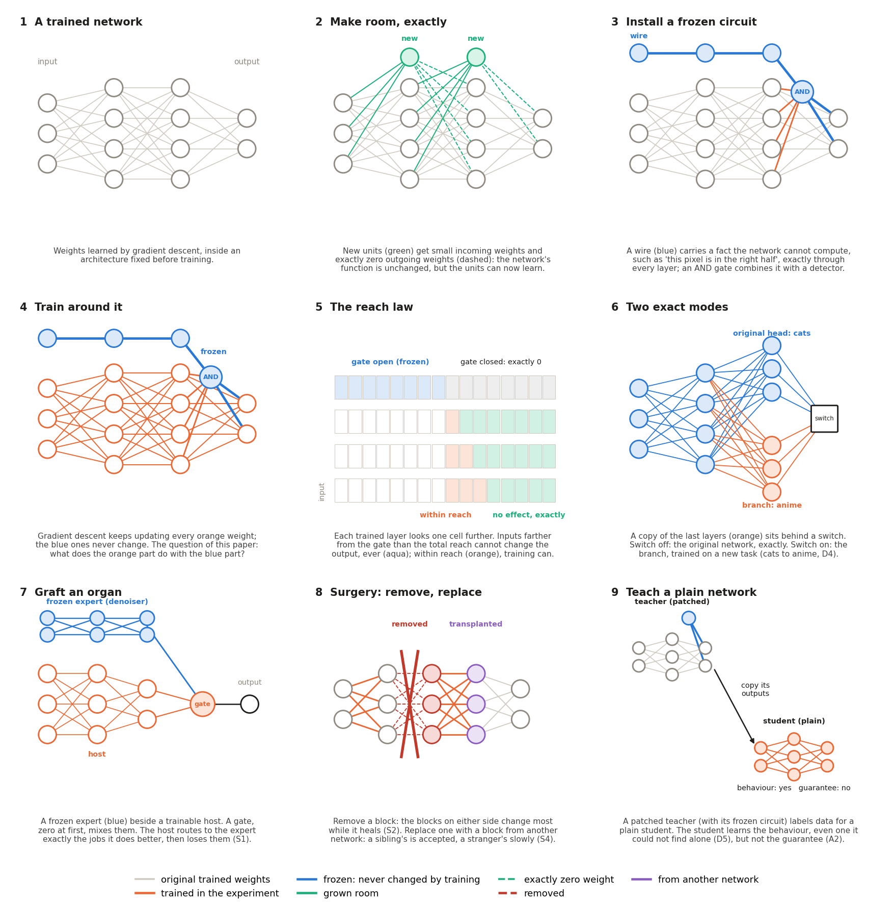
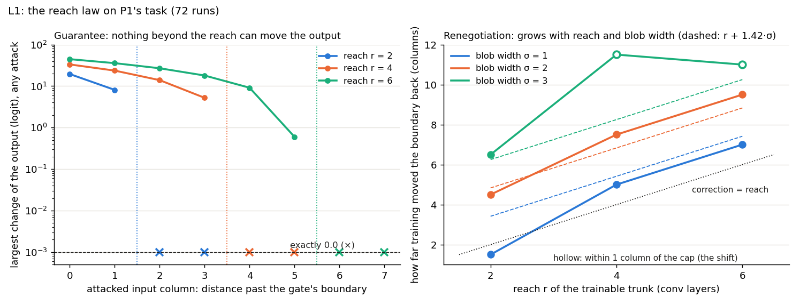
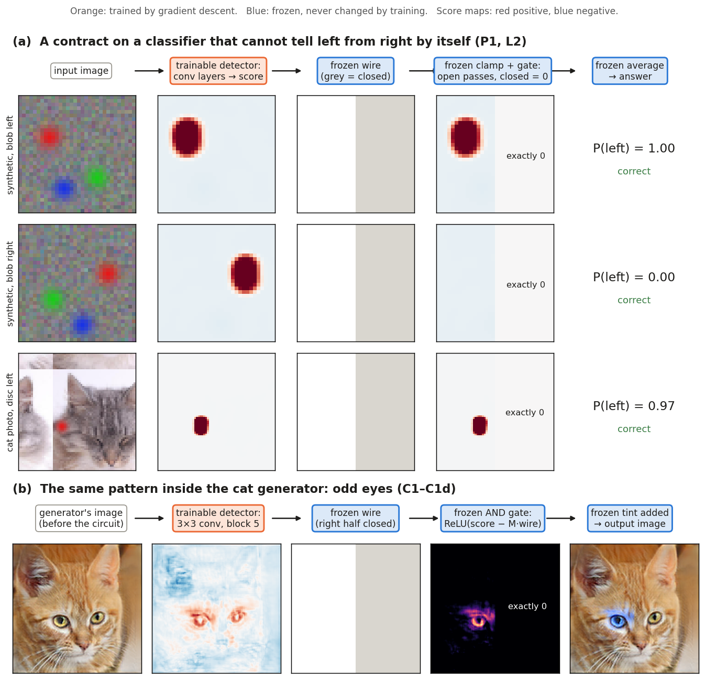
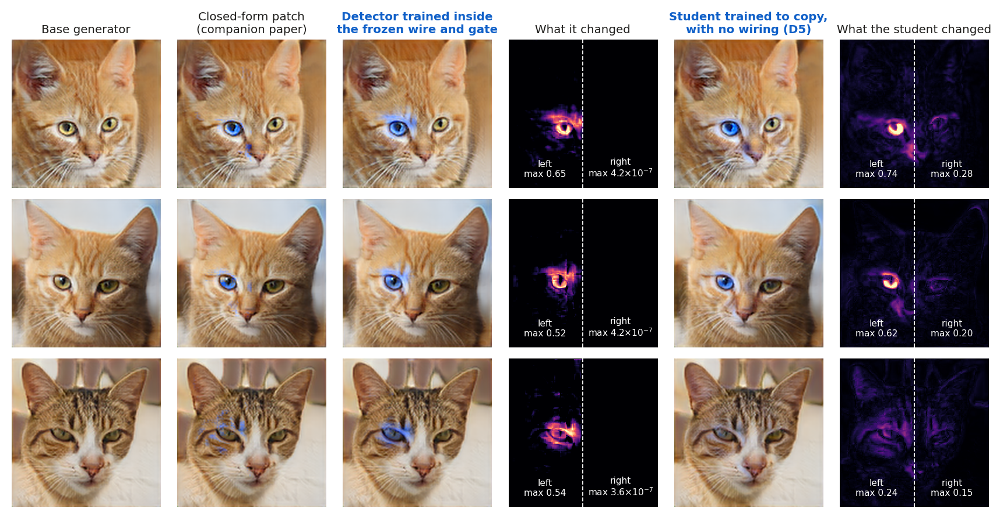
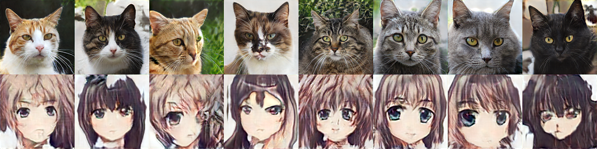
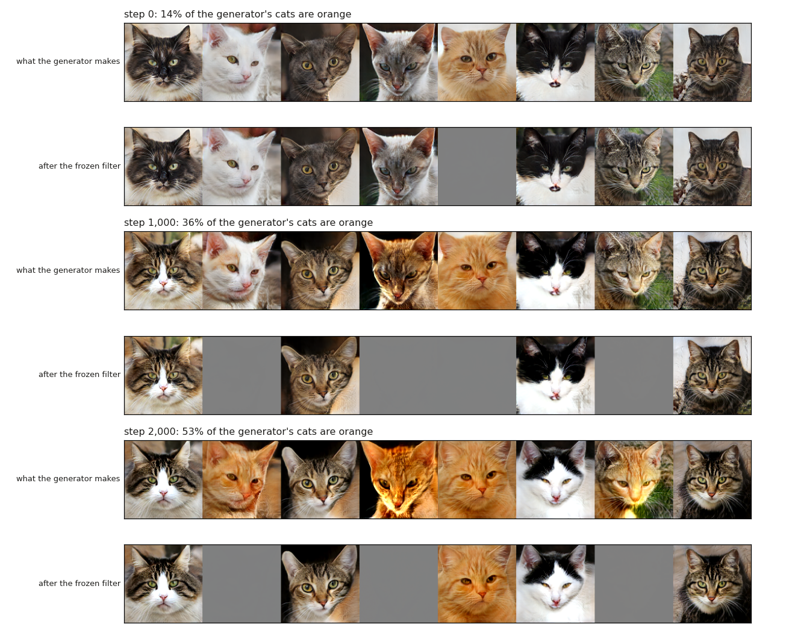

# Exact Beyond Reach

### What gradient descent can and cannot change after an AI agent patches a neural network's weights

**[Read the paper](https://v-code-895.github.io/exact-beyond-reach/)** ([PDF](paper/exact_beyond_reach.pdf)) · Voravee Upatising and Claude (Anthropic; Claude Opus 5.5)

An LLM coding agent can write exact structure straight into a trained network's weights: a wire that tells the network
"this pixel is in the right half", an AND gate, a hard filter, a switch between two whole modes
([companion paper](https://github.com/v-code-895/wsse)). Real models keep training after they are patched. So what does gradient
descent do to a frozen patch, and with it? We ran **39 pre-registered experiments** on a synthetic classifier, a super-resolution
network, a cat GAN and Pythia-160M to find out.

## The reach law

> **A frozen patch fixes, exactly, everything beyond the reach of the trainable layers in front of it.
> Everything within that reach, including the patch's own boundary, training can renegotiate.**

- **Exact.** We attacked 39 trained networks, letting the attacker repaint any input column it liked. Beyond the trainable reach the
  output moved by **exactly 0.0, every time**, on synthetic images and real cat photos, across three reaches and three architectures.
  One column inside the reach, the same attack moves it.
- **Renegotiated.** Put the patch's boundary in the wrong place and training quietly moves it back: by up to about 7 columns, roughly
  the reach plus 1.4 object widths, and less when the object is hard to see against its background.

## What the patches let a network do

**Learn what it provably cannot.** A shift-equivariant network can never tell left from right: it sits at 50% at every training-set
size. With a frozen gate it learns the task from 8 examples, does it **zero-shot (88%) using a detector it learned for something
else**, and becomes an exact robustness certificate.

**Odd-eyed cats, exactly.** Gradient descent cannot find "blue left eye only" from real cat photos. Train just the detector inside
the agent's frozen wire and gate, and the left iris turns blue while the right half of every image stays unchanged to
**4 × 10⁻⁷**. A plain network taught by copying the patched one learns the odd eyes too, but drifts on the right half.

**One network, two exact modes.** Behind an exact switch, the cat generator is unchanged to 10⁻¹⁵; flip it, and a branch trained only
on anime faces turns each cat into an anime face that keeps the cat's pose.

## How training reorganises around a patch

- **It hands jobs over, then forgets them.** Graft a frozen expert denoiser next to a network: it routes exactly the inputs the
  expert handles better, and its own denoising withers (+0.97 dB on its own, against +3.18 dB without the graft).
- **It deletes its own copy, but only if keeping it costs something.** Remove a fixed shortcut and the network rebuilds it; put the
  shortcut back and the network's copy is gone within about 500 steps. An unused copy with nothing competing for it stays.
- **Structure has a price in width.** A fixed bicubic shortcut is worth 2.2×, 1.7× and about 1.4× the width of a 24-, 48- and
  96-channel network. For a task the architecture cannot do, no width helps at all.
- **Healing is local.** Cut out a block and the blocks next to the gap change most while the network heals.

## Where it breaks

- **Guarantees don't distil.** Students trained on a guarded teacher's outputs match it on the data and break its bound on
  **100% of attacks**; the teacher's violation is exactly zero.
- **Margins leak.** A fact grown into Pythia-160M survives continued training (Rome at 0.98, against 0.29 for the same edit made
  by fine-tuning), but its weights still move: rare gradients, magnified by Adam.
- **Filters become traps.** A frozen "no orange cats" filter inside GAN training survives exactly, and pulls the generator into
  making *more* orange cats (14% → 53%), which it then greys out.

## How the work was done

Every experiment was registered (arms, metrics, numeric predictions) in [`PREREG.md`](PREREG.md) and committed before it ran.
[`RESULTS.md`](RESULTS.md) reports each one against its predictions, including the roughly one in three that failed;
[`LOG.md`](LOG.md) records every change of plan. One script per experiment is in [`src/`](src/), with outputs in `results/`.
To reproduce, use the [companion repository](https://github.com/v-code-895/wsse)'s environment and trained models; datasets and
Pythia-160M are not included. The paper builds with `python paper/build_paper.py`. MIT licence.
